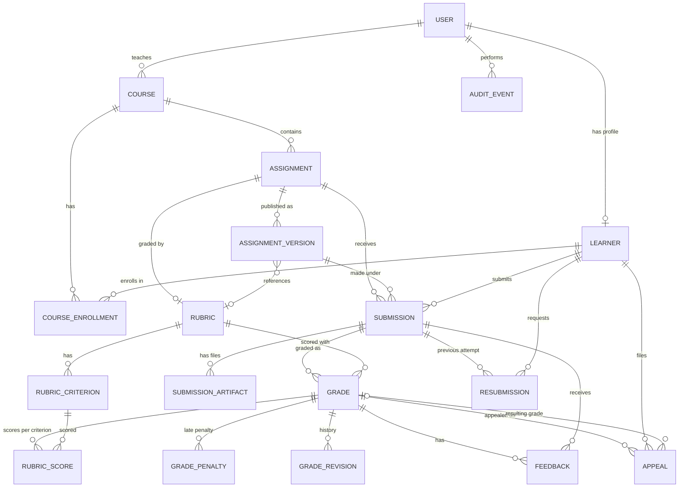

# Assignment Lifecycle and Grading Management System

A full-stack system for the whole life of an assignment: courses and enrollments, assignment creation and publication, rubrics, submissions and artifact metadata, rubric-based grading, late penalties, resubmissions, appeals and grade revisions, audit history, synthetic data generation, data-quality validation, analytics and exports.

| Layer | Technology |
|---|---|
| Frontend | React + Vite + Tailwind CSS, React Router, Axios, Recharts, Lucide icons |
| Backend | Python, FastAPI, Uvicorn |
| Database | SQLite (foreign keys enforced on every connection) |
| ORM / migrations | SQLAlchemy 2.0, Alembic |
| Validation / settings | Pydantic, pydantic-settings |
| Auth | JWT access tokens, Argon2 password hashing (pwdlib) |
| Data generation | Faker, NumPy, pandas (fixed seed `20261022`) |
| Tests | Pytest + HTTPX (backend), Vitest + Testing Library (frontend) |

---

## Contents

1. [Verification status](#1-verification-status)
2. [Project structure](#2-project-structure)
3. [Setup, migrations and startup](#3-setup-migrations-and-startup)
4. [Configuration](#4-configuration)
5. [Roles and permission matrix](#5-roles-and-permission-matrix)
6. [Business rules](#6-business-rules)
7. [ER diagram](#7-er-diagram)
8. [Data dictionary](#8-data-dictionary)
9. [API documentation](#9-api-documentation)
10. [Synthetic data generator (CLI)](#10-synthetic-data-generator-cli)
11. [Data-quality validation](#11-data-quality-validation)
12. [Exports, manifest and checksums](#12-exports-manifest-and-checksums)
13. [Frontend screens](#13-frontend-screens)
14. [Tests and test report](#14-tests-and-test-report)
15. [Demo walkthrough](#15-demo-walkthrough)
16. [Known limitations](#16-known-limitations)

---

## 1. Verification status

This section is the honest record of what has and has not been run. **Update it with real results; do not mark anything as passed that you have not executed.**

| Item | Status | How to verify | Result |
|---|---|---|---|
| Backend test suite | Not yet executed | `cd backend && pytest` | _fill in: passed / failed / skipped_ |
| Frontend test suite | Not yet executed | `cd frontend && npm test` | _fill in_ |
| Migration from empty database | Not yet executed | `alembic upgrade head` | _fill in_ |
| Starter dataset regenerated | Not yet executed | see [section 10](#10-synthetic-data-generator-cli) | _fill in_ |
| Full dataset (1,000 / 10,000 / 30,000) | Not yet generated | `--mode full` | _fill in actual counts_ |
| Reproducibility (two runs, same seed) | Covered by a test, not yet run | `pytest tests/test_generators.py` | _fill in_ |
| Full-size generation time | Not measured | `RUN_SLOW=1 pytest -m slow` | _fill in_ |

Committed files under `data/` (manifest, ground truth) were produced by an earlier version of the generator. Regenerate them (section 10) before relying on them.

---

## 2. Project structure

```
assignment-lifecycle-management/
├── backend/
│   ├── alembic.ini
│   ├── migrations/               Alembic environment and versions (001_initial_schema.py)
│   ├── requirements.txt
│   ├── pytest.ini
│   ├── app/
│   │   ├── main.py               FastAPI app, CORS, error handlers, startup admin bootstrap
│   │   ├── api/v1/               Routers (auth, courses, learners, assignments, submissions,
│   │   │                         grades, resubmissions, appeals, audit, analytics, datasets)
│   │   ├── core/                 config, database, security, deps, lifecycle rules, errors, ids, time
│   │   ├── models/               SQLAlchemy 2.0 models
│   │   ├── schemas/              Pydantic request/response schemas
│   │   ├── services/             Business logic (grading, appeals, resubmissions, access, audit...)
│   │   ├── generators/           Synthetic data generator, CLI, checksums
│   │   └── validators/           Data-quality engine and ground-truth handling
│   └── tests/
├── frontend/
│   ├── src/api/                  Central Axios client and endpoint helpers
│   ├── src/auth/                 Auth context and role permission map
│   ├── src/components/           Reusable UI (Layout, ScoreBreakdown, Toast, ...)
│   ├── src/lib/                  Formatters, checksum hashing
│   ├── src/pages/                One file per screen
│   └── src/test/                 Vitest setup
├── data/
│   ├── starter/                  CSV + JSON per entity, seed.sql, manifest.json
│   ├── full/                     Created by `--mode full`
│   ├── manifests/                Source manifests (<mode>_<seed>.json)
│   └── ground_truth/             Evaluation-only anomaly labels (CSV + JSON)
├── docs/                         Validation summary written by the validator
├── prompt.md                     The project prompt (stack and step-by-step brief)
└── README.md
```

---

## 3. Setup, migrations and startup

Requirements: Python 3.11+ and Node.js 18+.

### Windows PowerShell

```powershell
# Backend
cd backend
python -m venv .venv
.\.venv\Scripts\Activate.ps1
pip install -r requirements.txt
alembic upgrade head                      # creates the SQLite schema
uvicorn app.main:app --reload             # http://localhost:8000  (Swagger UI: /docs)

# Frontend (new terminal)
cd frontend
npm install
npm run dev                               # http://localhost:5173
```

If PowerShell blocks activation: `Set-ExecutionPolicy -Scope Process -ExecutionPolicy Bypass`.

### macOS / Linux

```bash
cd backend
python -m venv .venv && source .venv/bin/activate
pip install -r requirements.txt
alembic upgrade head
uvicorn app.main:app --reload

cd ../frontend && npm install && npm run dev
```

### Migrations

```bash
alembic upgrade head                      # apply
alembic current                           # show the applied revision
alembic downgrade base                    # roll everything back
alembic revision --autogenerate -m "describe the change"   # after changing a model
```

The circular foreign key (`assignments.current_version_id` ↔ `assignment_versions`) is created in SQLite batch mode. Tests build the schema with `create_all()` on a temporary database; production and demo use Alembic.

### First sign-in

A platform administrator is created at startup if no user exists: `admin@demo.local` / `DemoPass123!` (from `backend/.env`). Change these for anything beyond a demo.

---

## 4. Configuration

Backend settings (`backend/.env`, read by pydantic-settings):

| Variable | Default | Purpose |
|---|---|---|
| `DATABASE_URL` | `sqlite:///./assignment_management.db` | Database location |
| `SECRET_KEY` | `change-me-to-a-long-random-string` | JWT signing key. **Replace before any real use.** |
| `ALGORITHM` | `HS256` | JWT algorithm |
| `ACCESS_TOKEN_EXPIRE_MINUTES` | `480` | Token lifetime |
| `CORS_ORIGINS` | `http://localhost:5173,http://127.0.0.1:5173` | Allowed browser origins |
| `BOOTSTRAP_ADMIN_EMAIL` / `BOOTSTRAP_ADMIN_PASSWORD` | `admin@demo.local` / `DemoPass123!` | First administrator |
| `GENERATOR_SEED` / `GENERATOR_MODE` | `20261022` / `starter` | Generator defaults |

Frontend (`frontend/.env`): `VITE_API_BASE_URL` (default `http://localhost:8000/api/v1`).

Keep `.env` and `*.db` out of Git (see `.gitignore`).

---

## 5. Roles and permission matrix

Every rule is enforced by the backend (`backend/app/services/access.py`). The UI only hides actions (`frontend/src/auth/permissions.js`).

| Capability | Learner | Instructor | Academic admin | Support staff | Platform admin |
|---|:-:|:-:|:-:|:-:|:-:|
| View overview dashboard / audit trail | – | ✔ | ✔ | ✔ | ✔ |
| Create course | – | ✔ | ✔ | – | ✔ |
| Update course | – | own courses | ✔ | – | ✔ |
| Create learner | – | – | ✔ | ✔ | ✔ |
| View learner list | – (own record) | ✔ | ✔ | ✔ | ✔ |
| Enroll learners | self only | ✔ | ✔ | ✔ | ✔ |
| Create / edit / publish assignment and rubric | – | own courses | ✔ | – | ✔ |
| Submit work | ✔ (enrolled) | – | – | – | – |
| Read submissions, grades, feedback, revisions | own only | own courses | ✔ | ✔ | ✔ |
| Grade and revise grades | – | own courses | ✔ | – | ✔ |
| Request resubmission | ✔ | – | – | – | – |
| Decide resubmission | – | own courses | ✔ | – | ✔ |
| File appeal | ✔ (own grade) | – | – | – | – |
| Review / decide appeal | – | own courses | ✔ | – | ✔ |
| Data-quality report, dataset exports | – | – | ✔ | – | ✔ |
| Generate datasets | – | – | – | – | ✔ |

Learners can never grade, and can never read another learner's submissions, grades, feedback or revision history.

---

## 6. Business rules

### Lifecycles (valid transitions only)

| Entity | States and transitions |
|---|---|
| Assignment | `draft → published → closed → archived` |
| Enrollment | `enrolled → dropped` or `enrolled → completed` |
| Submission | `submitted → graded → returned`; `submitted → withdrawn` |
| Resubmission | `requested → approved \| denied`; `approved → completed` |
| Appeal | `submitted → under_review → approved \| rejected \| upheld` |

Invalid transitions are rejected with HTTP 422.

### Publication

An assignment can be published only if it has a rubric with at least one criterion and a positive maximum, and a due date later than the publication time. Publishing creates an immutable `AssignmentVersion` that stores the title, description, due date and rubric reference, so every submission is interpreted against the version it was made under.

### Submissions

Only learners enrolled (status `enrolled`) in the course may submit, and only to a published assignment. A submission is late when it arrives after `due_at`; it is rejected if the assignment does not allow late work. The first attempt is version 1; later attempts go through the resubmission workflow. Artifact metadata (filename, MIME type, size, SHA-256, availability status `available | missing | quarantined`) is stored; file contents are not.

### Grading and rounding

* Every criterion must be scored exactly once, between 0 and the criterion maximum.
* Each score is rounded **half-up to 2 decimals**, then summed: `raw = Σ round(score)`.
* **Late penalty** (only when the submission is late, late work is allowed and the penalty percentage is above 0, unless the grader waives it):
  `penalty = round(raw × percent / 100)`, `final = max(0, raw − penalty)`.
* The penalty is applied **at most once per submission** (database unique constraint on `submission_id + penalty_type`). A revision recalculates it from the new raw score instead of adding a second one, and a waived penalty stays waived.
* A submission has one current grade. Grading again is a conflict; use a revision.

### Revisions

Revising a grade requires a non-empty reason, creates a new `Grade` row (`revision_number + 1`, status `revised`), marks the old one `superseded`, and writes a `GradeRevision` and an audit event. Earlier grades are never overwritten.

### Resubmissions

Allowed only if the assignment's `resubmission_policy` is `instructor_approval` or `automatic` and `max_resubmissions` is above 0. The previous submission must belong to the requesting learner and assignment. Only one request may be open at a time. `automatic` approves immediately; otherwise an instructor decides. Completing an approved request creates the next submission version linked to the request. Prior submissions, artifacts and grades are preserved.

### Appeals: decision model

| Decision | Effect on the grade | Requirements |
|---|---|---|
| `approved` | New grade revision with revised criterion scores | Revised scores and a decision reason |
| `rejected` | None | Decision reason |
| `upheld` | None (the original grade is confirmed) | Decision reason |

Only the **current** grade can be appealed, once per learner per grade. For `approved`, the new grade, the revision, the audit events and the appeal update are committed in **one transaction**: if any step fails (including the audit write), nothing is saved. `rejected` and `upheld` write an `appeal_no_change` audit event on the grade plus a `decide` event on the appeal.

### Audit

Audit events record actor, entity type and id, action, from/to state, a JSON payload and a UTC timestamp for creation, publication, submission, grading, revision, resubmission and appeal actions.

### Identifiers and time

Public identifiers are deterministic and zero-padded (`CRS-000001`, `LRN-0000001`, `SUB-0000001`, `GRD-000001`, `AUD-00000001` ...). Timestamps are stored in UTC and compared as timezone-aware values.

---

## 7. ER diagram



---

## 8. Data dictionary

Conventions: `id` is an integer primary key; `public_id` is a unique, indexed, zero-padded text identifier; all `*_at` columns are UTC timestamps; scores and penalties are `NUMERIC(10,2)` points (percent columns are `NUMERIC(5,2)`). "Req" = required.

| Table | Key columns | Constraints and rules |
|---|---|---|
| `users` | `public_id`, `email` (req, unique, lower-cased), `password_hash` (Argon2), `full_name`, `role` (`learner`, `instructor`, `academic_admin`, `support_staff`, `platform_admin`), `is_active` (default true) | Only learners may self-register; staff roles need an administrator |
| `learners` | `user_id` (FK, unique), `student_number` (req, unique, ≤ 32), `status` (default `active`) | One profile per user |
| `courses` | `code` (req, unique, ≤ 32), `title`, `description`, `term`, `instructor_id` (FK users), `status` (default `active`) | |
| `course_enrollments` | `course_id`, `learner_id` (FKs), `status` (`enrolled`, `dropped`, `completed`), `enrolled_at` | Unique per course + learner |
| `assignments` | `course_id` (FK), `title`, `description`, `status` (`draft`, `published`, `closed`, `archived`), `current_version_id` (FK, nullable), `due_at`, `published_at`, `allow_late` (default true), `late_penalty_percent` (0–100, default 10.00), `max_resubmissions` (default 1), `resubmission_policy` (`none`, `instructor_approval`, `automatic`), `created_by_id` | |
| `assignment_versions` | `assignment_id`, `version_number`, `title`, `description`, `due_at`, `published_at`, `rubric_id` | Unique per assignment + version number; immutable once created |
| `rubrics` | `assignment_id` (FK, unique), `name`, `version_number`, `max_score` (sum of criteria) | One rubric per assignment |
| `rubric_criteria` | `rubric_id` (FK, cascade), `name`, `description`, `max_score` (> 0), `weight` (default 1.000), `sort_order` | |
| `submissions` | `assignment_id`, `assignment_version_id`, `learner_id` (FKs), `version_number` (≥ 1), `submitted_at`, `is_late`, `status` (`submitted`, `graded`, `returned`, `withdrawn`) | Unique per assignment + learner + version number |
| `submission_artifacts` | `submission_id` (FK, cascade), `filename`, `mime_type`, `file_size_bytes` (≥ 0), `checksum_sha256` (64 hex, lower-case), `uploaded_at`, `availability_status` (`available`, `missing`, `quarantined`) | Metadata only |
| `grades` | `submission_id`, `assignment_version_id`, `rubric_id`, `revision_number`, `is_current`, `raw_score`, `late_penalty_applied`, `late_penalty_amount`, `final_score`, `status` (`draft`, `posted`, `revised`, `superseded`), `grader_id` | Unique per submission + revision number; invariant `final = max(0, raw − penalty)` |
| `rubric_scores` | `grade_id` (FK, cascade), `criterion_id` (FK), `score` | Unique per grade + criterion; `0 ≤ score ≤ criterion max` |
| `grade_penalties` | `grade_id`, `submission_id`, `penalty_type` (default `late`), `amount` | **Unique per submission + penalty type** (penalty applied once) |
| `grade_revisions` | `grade_id`, `submission_id`, `previous_final_score` (null for the first grade), `new_final_score`, `reason` (req), `changed_by_id` | Append-only |
| `feedback` | `grade_id` (nullable), `submission_id`, `author_id`, `body` | Append-only |
| `resubmissions` | `assignment_id`, `learner_id`, `previous_submission_id`, `resulting_submission_id` (nullable), `status`, `requested_at`, `decided_at`, `decided_by_id`, `decision_reason` | |
| `appeals` | `grade_id`, `submission_id`, `learner_id`, `reason`, `evidence_refs`, `status`, `reviewer_id`, `decision` (`approved`, `rejected`, `upheld`), `decision_reason`, `created_at`, `decided_at`, `resulting_grade_id` | Unique per grade + learner |
| `audit_events` | `actor_id` (nullable), `entity_type`, `entity_id`, `action`, `from_state`, `to_state`, `payload` (JSON text), `created_at` | Append-only |

SQLite foreign keys are switched on for every connection (`PRAGMA foreign_keys=ON`, see `backend/app/core/database.py`).

---

## 9. API documentation

Interactive documentation: **http://localhost:8000/docs** (Swagger UI) and `/redoc`. Base path `/api/v1`; `GET /health` is unauthenticated. Authenticate with `Authorization: Bearer <token>`.

Errors use `{"detail": "...", "code": "..."}`: 401 unauthenticated, 403 forbidden, 404 not found, 409 conflict, 422 validation or invalid transition.

| Area | Endpoints |
|---|---|
| Auth | `POST /auth/register`, `POST /auth/login`, `GET /auth/me` |
| Courses | `GET /courses`, `POST /courses`, `PATCH /courses/{id}`, `GET /courses/enrollments`, `POST /courses/enrollments` |
| Learners | `GET /learners`, `POST /learners` |
| Assignments | `GET /assignments`, `POST /assignments`, `GET /assignments/{id}`, `PATCH /assignments/{id}`, `POST /assignments/{id}/publish`, `GET /assignments/{id}/versions` |
| Rubrics | `POST /assignments/rubrics`, `GET /assignments/{id}/rubric` |
| Submissions | `GET /submissions` (filters `assignment_id`, `learner_id`, `status`), `POST /submissions`, `GET /submissions/{id}` |
| Grades | `POST /grades`, `GET /grades/{id}`, `POST /grades/{id}/revise`, `GET /submissions/{id}/grades`, `/feedback`, `/revisions` |
| Resubmissions | `GET /resubmissions`, `POST /resubmissions`, `POST /resubmissions/{id}/decision`, `POST /resubmissions/{id}/submit` |
| Appeals | `GET /appeals`, `POST /appeals`, `POST /appeals/{id}/review`, `POST /appeals/{id}/decision` |
| Audit | `GET /audit-events` |
| Analytics | `GET /analytics/overview` |
| Datasets | `POST /datasets/generate`, `POST /datasets/validate`, `GET /datasets/exports`, `GET /datasets/exports/{mode}/{filename}` |

List endpoints are paginated (`page`, `page_size` ≤ 100) and return `{items, total, page, page_size}`.

### Example: grade a late submission

```http
POST /api/v1/grades
{"submission_id": 12, "scores": [{"criterion_id": 1, "score": 50}, {"criterion_id": 2, "score": 30}], "feedback": "Good structure."}
```
```json
{"id": 7, "public_id": "GRD-000007", "submission_id": 12, "revision_number": 1, "is_current": true,
 "raw_score": "80.00", "late_penalty_applied": true, "late_penalty_amount": "8.00",
 "final_score": "72.00", "status": "posted"}
```

### Example: approve an appeal

```http
POST /api/v1/appeals/3/decision
{"decision": "approved", "decision_reason": "Rubric misapplied",
 "scores": [{"criterion_id": 1, "score": 60}, {"criterion_id": 2, "score": 30}]}
```
The response has `status: "approved"` and `resulting_grade_id` pointing at the new current grade (revision 2); the old grade becomes `superseded`.

---

## 10. Synthetic data generator (CLI)

Fixed seed: **20261022**. The same rules produce the starter and the full dataset.

| Mode | Instructors | Courses | Learners | Assignments | Submissions (target) | Criteria per rubric |
|---|---:|---:|---:|---:|---:|---:|
| `starter` | 2 | 3 | 20 | 8 | 40 | 3 |
| `full` | 20 | 50 | 10,000 | 1,000 | 30,000 | 4 |

Resubmissions (5 % of the target) are included in the submission total, so first attempts are 95 % of it.

```bash
cd backend
python -m app.generators.cli --mode starter --force      # small demo set
python -m app.generators.cli --mode full --force         # 1,000 / 10,000 / 30,000
python -m app.generators.cli --mode starter --seed 7     # different seed
python -m app.generators.cli --mode starter --no-export  # database only, no files
```

| Option | Meaning |
|---|---|
| `--mode starter\|full` | Dataset size |
| `--seed N` | Random seed (default 20261022) |
| `--force` | Replace existing data. Without it a non-empty database is refused, which prevents accidental duplicates |
| `--no-export` | Skip CSV/JSON/SQL files |

Generation order: courses and learners → enrollments → assignments and versions → rubrics and criteria → submissions and artifact metadata → criterion scores and grades → feedback and revisions → resubmissions → appeals and decisions → audit events → anomaly injection. Child rows are created only after their parents exist; scores, penalties and statuses are calculated from the source rows. The same data can also be generated from the UI (*Datasets & export*, platform admin only) or `POST /datasets/generate`.

Full generation inserts roughly 100,000+ rows and takes noticeably longer than the starter set; record your observed time in [section 1](#1-verification-status).

---

## 11. Data-quality validation

`validate_database` (`backend/app/validators/engine.py`) inspects the database only. **It never reads ground-truth files** (a test enforces this).

Checks: duplicate identifiers and foreign-key integrity, allowed enum values, assignment lifecycle states, deadline logic (`is_late` versus `due_at`), rubric maximums (grade and criterion level), duplicate late-penalty rows, final-score arithmetic (`final = raw − penalty`), and audit history for approved appeals.

### The four required anomaly scenarios

| Issue type | What is wrong | How it is detected |
|---|---|---|
| `unenrolled_submission` | A submission belongs to a learner who is not enrolled in the course | No active enrollment for (course, learner) |
| `grade_exceeds_rubric_max` | A grade's raw score is above the rubric maximum | `raw_score > rubric.max_score` |
| `duplicate_late_penalty` | The late penalty is taken off the final score more than once | `final_score ≠ raw − recorded penalty` (a second penalty row is blocked by the database) |
| `appeal_grade_change_without_audit` | An approved appeal changed a grade with no audit event | No `revise`/`grade` audit event for the resulting grade |

**Application rejection versus offline detection.** The API refuses these cases at write time (HTTP 403/422/409). The anomalies exist only because the generator plants them directly in the data, simulating bad imports or manual edits; the offline validator is what finds them.

### Ground truth and scoring

`data/ground_truth/ground_truth.csv|json` hold `issue_type, ground_truth, affected_entity_type, affected_entity_id, expected_behavior, explanation`, with real row ids written by the generator. `compare_to_ground_truth` matches detected `(issue_type, entity_id)` pairs against the labels and reports true/false positives, false negatives, precision, recall, F1 and a confusion matrix (true negatives are not defined for an open-ended anomaly search and are reported as `null`).

`POST /datasets/validate` (administrators) returns the report with pass/fail status, counts by type and examples, and writes `docs/validation-summary.json|md`.

---

## 12. Exports, manifest and checksums

Each mode writes to `data/<mode>/`: one CSV and one JSON per entity (users, learners, courses, enrollments, assignments, assignment_versions, rubrics, rubric_criteria, submissions, artifacts, grades, rubric_scores, grade_revisions, feedback, resubmissions, appeals, audit_events), a `seed.sql` of `INSERT` statements (foreign keys off during load), and `manifest.json`. A copy of the manifest is kept at `data/manifests/<mode>_<seed>.json`.

The manifest records the seed, mode, row counts and, per entity, the row count, a **logical SHA-256**, and the SHA-256 of the CSV and JSON files. The logical checksum excludes generation timestamps (`created_at`, `updated_at`, `uploaded_at`, `enrolled_at`, `requested_at`, `decided_at`) and `password_hash` (Argon2 salts differ on every run), so two runs with the same seed must produce identical logical checksums even though the raw files differ.

Load the SQL seed into a database built from the application schema:
```bash
sqlite3 assignment_management.db < data/starter/seed.sql
```

---

## 13. Frontend screens

| Screen | Route | Roles |
|---|---|---|
| Login | `/login` | all |
| Overview dashboard | `/` | staff |
| Courses & enrollments | `/courses` | all (create/enroll by permission) |
| Learners | `/learners` | staff |
| Assignments (create, edit, publish, versions) | `/assignments` | staff view; instructors/admins manage |
| Rubric editor | `/assignments/:id/rubric` | staff view; instructors/admins edit |
| My assignments + submit | `/my-assignments` | learner |
| Submissions, versions & artifacts | `/submissions`, `/submissions/:id` | all |
| Grading workspace | `/grading` | instructors/admins |
| Grades, feedback & revisions | `/grades`, `/grades/:submissionId` | all |
| Resubmissions | `/resubmissions` | all |
| Appeals | `/appeals` | all |
| Audit trail | `/audit` | staff |
| Datasets & export | `/datasets` | admins (generate: platform admin) |
| Data-quality report | `/data-quality` | admins |

The dashboard shows totals, on-time/late and missing-artifact rates, pending grading workload, grading turnaround, average raw and final grades, resubmission rate and score improvement, appeal rate and outcomes, grade-change rate, and the data-quality pass rate with anomaly counts, all from `GET /analytics/overview`. Pages use one Axios client, with loading, error and empty states, pagination and filters. The browser hashes chosen files (SHA-256); only the metadata is sent.

---

## 14. Tests and test report

### Backend (pytest, a temporary SQLite database per test)

```bash
cd backend
pytest                          # everything except the full-size check
pytest -v                       # per-test results
RUN_SLOW=1 pytest -m slow       # generates 1,000 / 10,000 / 30,000
```

| File | Covers |
|---|---|
| `test_auth.py` | registration, login, role restrictions |
| `test_courses_assignments.py` | course and assignment workflow, duplicate enrollment, publication rules |
| `test_lifecycle_rules.py` | rounding, late-penalty arithmetic, transition tables |
| `test_grading.py` | scoring, over-maximum scores, single late penalty, revisions, who may grade or read |
| `test_submissions.py` | enrollment, deadlines, versions, artifacts, visibility |
| `test_appeals.py` | filing rules, decisions, preserved history, atomic audit |
| `test_resubmissions.py` | request → decision → new attempt, attempt limits, ownership |
| `test_validators.py` | each anomaly detected, clean data passes, ground-truth scoring, label isolation |
| `test_generators.py` | seed determinism, volumes, injected anomalies with real ids, CSV/JSON/SQL export |

### Frontend (Vitest + Testing Library, jsdom, no API needed)

```bash
cd frontend
npm install
npm test
```
Covers the permission map and navigation, formatters and late-penalty preview, the Axios client, `ScoreBreakdown`, the login flow and checksum hashing.

### Reproducibility check

```bash
cd backend
pytest tests/test_generators.py -k "same_seed or reproducible"
```
This generates the starter dataset twice with seed 20261022 in separate databases and compares row counts and per-table logical checksums. To compare the **full** dataset, run `--mode full` twice (into two different `DATABASE_URL` files) and compare the `checksums` sections of the two manifests.

### Test report (fill in after running)

| Suite | Command | Passed | Failed | Skipped | Date |
|---|---|---:|---:|---:|---|
| Backend | `pytest` | _ | _ | _ | _ |
| Backend slow | `RUN_SLOW=1 pytest -m slow` | _ | _ | _ | _ |
| Frontend | `npm test` | _ | _ | _ | _ |

| Dataset check | Expected | Actual |
|---|---:|---:|
| Assignments | 1,000 | _ |
| Learners | 10,000 | _ |
| Submissions (all attempts) | 30,000 | _ |
| Users (3 staff + 20 instructors + learners) | 10,023 | _ |
| Logical checksums equal across two runs | all entities | _ |
| Generation time (full) | – | _ |

---

## 15. Demo walkthrough

1. **Start** the backend and frontend (section 3) and sign in as `admin@demo.local` / `DemoPass123!`.
2. **Generate data:** *Datasets & export* → `starter` → Generate. Generated accounts all use `DemoPass123!`: `academic@demo.local`, `support@demo.local`, `instructor0001@demo.local`, `learner0000001@demo.local`.
3. **Overview:** open the dashboard and note the anomaly counts and data-quality pass rate.
4. **Data quality:** open *Data-quality report*, run validation and review the four anomaly types with their example rows.
5. **Publish:** sign in as an instructor → *Assignments* → create an assignment → *Rubric editor* (add criteria) → publish, then open the version history.
6. **Submit:** sign in as an enrolled learner → *My assignments* → choose a file (its checksum is computed in the browser) → submit.
7. **Grade:** as the instructor → *Grading workspace* → score each criterion. The breakdown shows the raw total, the late penalty (percent of raw) and the final score.
8. **Revise:** open *Grades*, revise with a reason and see both versions in chronological order.
9. **Resubmit:** as the learner request a resubmission; as the instructor approve it; the learner submits version 2.
10. **Appeal:** as the learner appeal the current grade; as the instructor approve it with new scores. The new grade, the revision and the audit events appear together under *Audit trail*.

The same flow with the API (PowerShell):
```powershell
$base = "http://localhost:8000/api/v1"
$token = (Invoke-RestMethod "$base/auth/login" -Method Post -ContentType "application/json" `
  -Body '{"email":"admin@demo.local","password":"DemoPass123!"}').access_token
$h = @{ Authorization = "Bearer $token" }
Invoke-RestMethod "$base/analytics/overview" -Headers $h
Invoke-RestMethod "$base/datasets/validate" -Method Post -Headers $h
```

---

## 16. Known limitations

* Artifact **metadata** only; file contents are not uploaded or stored.
* Name lookups in the UI cover the first 100 courses, assignments and learners; others show as `#id`.
* Some filters (for example course status, appeal status) narrow the current page only because the API does not filter on them.
* No logout, token refresh, password change, user-management or learner-detail endpoints.
* SQLite is the only supported database; there is no Docker or CI configuration.
* `SECRET_KEY` and the demo passwords are placeholders for local use.
* Results in [section 1](#1-verification-status) and [section 14](#14-tests-and-test-report) must be filled in from actual runs.
